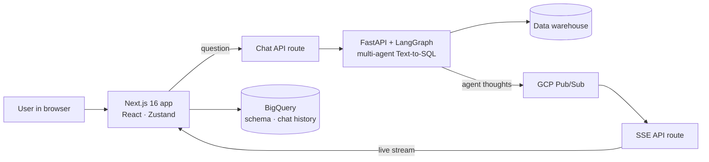

<h2 align="center">Hi, I'm Sharath 👋</h2>

  

  

---

### 🧭 About me

- 💼 **Senior Full Stack Engineer / Associate Manager** at a data & AI company, building products end to end and leading engineers
- 🤖 Built a **GenAI Text-to-SQL analytics assistant** for a large retail client's supply chain team: plain-English questions in, SQL, tables, charts and a live view of the agents' reasoning out ([details below](#-featured-work-genai-text-to-sql-analytics-assistant))
- 🚗 At **Amazon** (Smart Vehicles), shipped React Native component libraries for in-car launchers, a C++ message router to cut bridge overhead, and Perfetto-driven Time-To-First-Frame work
- ☁️ At **Amazon** (Halo), built a self-service Node.js API on **AWS CDK, Lambda, SQS, DynamoDB** that cut partner config updates from 1 day to 15 minutes
- 🛠️ 5 years of automation at **Ericsson** and test automation at **Cisco** (H-SDWAN, IPv6)
- 🌐 Networking roots: **BGP, OSPF, VxLAN, EVPN** · MS in Computer Networking, **NC State University**
- 🧑‍🔬 Open-source contributor: **CmyPlot**, **Expertiza**, **CheapBuy**
- 🔭 Currently building **Patterns**, a generative-art apparel studio in TypeScript + Rust
- ⚡ <s>Fun</s> fact: At any given moment, you would be doing the thing you most want to be doing 🤨

### 🛠️ Tech stack

  

### 🤖 Featured work: GenAI Text-to-SQL analytics assistant

*Enterprise project, closed source. Built for a supply chain analytics and measurement team.*

Business users ask questions like *"how did fulfillment center 1234 perform last week?"* in plain English. A multi-agent LangGraph backend rewrites the question, writes and validates SQL, runs it, and returns a summary, the SQL, result tables, charts and follow-up questions. While it works, each agent's reasoning streams live into a side panel.

**What I built**

- **Live chain of thought.** A Next.js route subscribes to GCP Pub/Sub per conversation and relays agent messages to the browser over Server-Sent Events, with heartbeats, typed events and subscription cleanup. The client service reconnects with backoff and validates every message with a type guard.
- **Answer rendering.** Responses render as summary, SQL, data tables, Plotly charts and recommended follow-ups, with star ratings and feedback on each answer.
- **Response profiles.** Executive, Analyst and Custom presets decide which sections a user sees. Changing any toggle switches the preset to Custom automatically. Preferences persist in a cookie, with a one-time migration from localStorage.
- **PDF export.** Users pick the sections to include. Charts are captured with `Plotly.toImage`, tables are trimmed for the page, and oversized tables download as CSV alongside the PDF (`@react-pdf/renderer`).
- **Data and auth.** A BigQuery gateway serves the warehouse schema and per-user chat history. Enterprise SSO runs through NextAuth with OAuth, plus a dev bypass.
- **Deployment.** Multi-stage Docker build to a Next.js standalone server running as a non-root user. Kubernetes rolling updates with zero downtime (`maxUnavailable: 0`), liveness and readiness probes, a pod disruption budget, and secrets mounted from a vault at deploy time instead of baked into the image. Sized autoscaling for 50 concurrent users holding long-lived SSE connections.

**Stack:** Next.js 16 (App Router) · TypeScript · Zustand · FastAPI · LangGraph · GCP Pub/Sub · BigQuery · SSE · Plotly · NextAuth · Docker · Kubernetes

### 🚀 Featured projects

| Project | What it does | Stack |
|---|---|---|
| **Patterns** *(private, in progress)* | Explore and generate mathematical art, tune parameters and palettes, then preview it on direct-to-garment printed apparel. A Rust render worker sits behind a job queue. | Next.js · TypeScript · Rust · BullMQ · Redis · MinIO |
| [**Assembly-Endgame**](https://github.com/sharathKV/Assembly-Endgame) | Hangman-style word game in React | React · JavaScript · CSS |
| [**Tenzies**](https://github.com/sharathKV/Tenzies) | Dice game showing `useState`, `useEffect` and `useRef` patterns | React · JavaScript · CSS |
| [**TCP-Analysis**](https://github.com/sharathKV/TCP-Analysis) | Throughput and flow-completion-time comparison of TCP Cubic vs DCTCP on a dumbbell topology | C++ · ns-3 |

### 💼 Experience

| Role | Where | When |
|---|---|---|
| Senior Full Stack Engineer / Associate Manager | Data & AI company · Bengaluru | Present |
| Software Development Engineer | Amazon, Smart Vehicles · Sunnyvale, CA | 2023 – 2024 |
| SDE Intern | Amazon, Halo · Bellevue, WA | 2022 |
| Software Engineer Intern | Cisco Systems · Raleigh, NC | 2022 |
| Automation Engineer | Ericsson · Bengaluru | 2015 – 2020 |

### 🎓 Education & certifications

- **MS, Computer Networking**, North Carolina State University (2021 – 2022)
- **BE, Electronics & Communications**, M S Ramaiah Institute of Technology (2011 – 2015)
- JNCIA DevOps (Juniper) · Ericsson Certified Associate, RAN Optimization · Oracle Certified Associate, Java SE 7

### 📊 GitHub stats

  

  

  <picture>
    <source media="(prefers-color-scheme: dark)" srcset="https://raw.githubusercontent.com/sharathKV/sharathKV/output/github-snake-dark.svg" />
    
  </picture>

